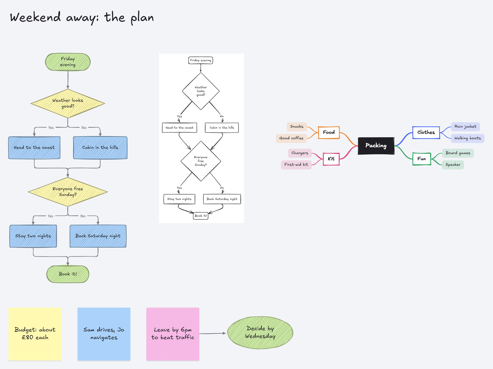

# BrainCraft

An infinite whiteboard for brainstorming: mind maps, flowcharts, tables,
Kanban boards, timelines and comments on one canvas. It runs entirely in the
browser as a static site, so you can host it anywhere.


## Look and feel

BrainCraft defaults to a **dark theme** and has three more: **light**,
**high contrast dark** and **high contrast light**. Pick one from the theme
button at the top right, or type "theme" in Ctrl+K. The high-contrast themes
use pure black and white surfaces, a vivid accent, bold outlines on every
shape, thicker lines and stronger focus rings. Default board colors (ink,
lines, frames, mind-map centers) follow the theme, so boards stay readable in
all four.

The board fills the window and the controls float above it:

- **Board menu** (top left): the board's icon and title, your boards, new,
  open, download, share, import and export, version history, connecting an AI
  assistant, and shortcuts.
- **Top right:** **Share** (in a live session, the **Live** button that shows
  who's here), **Ask AI**, **Present**, **Search** (Ctrl+K
  searches the board *and* runs any command by name; type `>` to show only
  commands), **Comments**, the theme and **Help** (?).
- **Tool rail** (left), grouped by what the tools are for: picking and
  moving, writing, thinking it through (mind maps, flowcharts, lines), and
  drawing (shapes, the pen, frames, Excalidraw). The last button holds tables,
  Kanban boards, timelines, databases, images and code blocks. Hover any tool
  to see its shortcut; every key still works.
- **Undo, redo and zoom** (bottom left), plus a **minimap** (bottom right).
- **Right-click** anything for the actions that apply to it.

| Dark | Light | High contrast dark |
| --- | --- | --- |
|  |  |  |

## Features

### Mind maps


- Press **M** and click to start a map, then type your central idea.
- **Tab** adds a sub-idea and **Enter** adds an idea below, so you can
  brainstorm without touching the mouse. An idea you leave empty is discarded.
- Branches lay themselves out on both sides of the central idea. Each main
  branch gets its own color, and its sub-ideas share it.
- Use the **arrow keys** to move between ideas and **Alt + ↑/↓** to reorder them.
- **Drag ideas anywhere.** Drop one on empty space and it stays there with its
  branch, and the lines follow. Drop it onto another idea to move the branch
  under it, or drag a main branch across the centre to switch sides.
  **Tidy mind map** (right-click) snaps everything back into the automatic
  layout.
- Select several ideas to move them together (the rest of the map stays
  put), or press **Ctrl+G** to group sibling ideas under a new one.
- **Collapse** a branch with **/** or with the toggle next to it.
- **Paste an indented list** (Markdown bullets, numbered lists, headings or
  plain indentation) to turn it into a map. A flat list with no indents
  becomes sticky notes instead (see below).
- **Outline** (on a selected idea's toolbar, or Ctrl K) opens the whole map
  as an indented list beside the board, kept in step both ways: type in the
  list and the map follows a moment after you stop; change the map and the
  list follows. Enter adds an idea at the same depth, Tab moves a line under
  the one above, Shift Tab moves it back out, and cutting a block and pasting
  it under another line moves that branch. Ideas that keep their words keep
  their colour, comments and place wherever they move. **Copy as Markdown**
  or **Download .md** gives the map as a heading with nested bullets (paste
  it back in for the same map).

### Flowcharts


- Press **D** (or pick the flowchart tool) to open the **shape panel**: Start/End,
  Process, Decision, Input/Output, Document, Database or Subprocess. It stays
  open while you build; close it with its **×** or **Esc**.
- **Drag shapes from the panel onto the board**, or click one and then click
  the board.
- **Magnets:** drop or drag a shape near another one and it snaps into line
  beside it, one gap away, and connects with an arrow automatically. The
  target glows and a dashed line previews the connection. Hold **Alt** to
  place it freely.
- With a shape selected, **Tab** adds the next connected step in the direction
  the flow is going. **Alt + arrow** adds one in that direction, e.g. the
  "No" branch of a decision. While you're typing in a shape, **Tab** finishes
  it and moves on to the next step.
- Selected shapes show **blue arrows** on each side. Click one to add a step
  that way, or drag it onto another shape (or onto empty space) to connect.
- New steps line up and space themselves automatically, sliding past shapes
  already in the way. Dragged shapes snap into line with their neighbors;
  hold **Alt** to move freely.
- Lines attach to the middle of a side and stay attached as you move things.
  Choose straight, right-angled or curved lines and which ends get arrows.
  **Double-click a line** to label it ("Yes", "No").
- Change a shape's symbol from the toolbar at any time.

- **Drag a blue arrow to empty space** and BrainCraft suggests the next
  shape, with a description of each. The order follows what this board uses
  most after that kind of shape, then the usual conventions. Press **1–7** to
  pick. **Shift-click** a blue arrow for the same choice, placed that way.
- **Mermaid:** paste a Mermaid flowchart (or use **Import / Export**) to build
  it, laid out automatically: steps line up in straight runs, and links that
  skip a step or loop back get a lane of their own. Export any flowchart back
  to Mermaid for docs and wikis that draw Mermaid diagrams.
- **Lines go around shapes:** a square-cornered line that would cut through
  something takes a way around it instead, keeping clear of other lines.
- **Lines hop where they cross:** where two lines cross (connectors and
  mind-map branches alike), the more level one jumps over the other in a
  small arc, so it's clear they pass rather than join.

A hint bar at the bottom of the canvas shows the shortcuts that apply to
whatever you have selected.

### Excalidraw drawings



(This board is in [examples/Weekend away.braincraft](examples/Weekend%20away.braincraft): drop it on BrainCraft to open it.)

- **A hand-drawn board, with BrainCraft's own tools:** the **Hand-drawn
  board** switch (the squiggle in the Draw group of the tool rail, or the ☰
  menu, or Ctrl+K) draws everything on the board by hand, and everything you
  add after: shapes, notes, text, frames, flowcharts and mind maps get wobbly
  pencil outlines, hatched fills and handwriting, and lines get pencil
  arrowheads. They're ordinary board objects, so they select, move, connect,
  take comments and sync live like everything else. Friends in a live session
  get the same switch.
- **Or draw in Excalidraw itself:** right-click empty space → **Excalidraw
  drawing**, or Ctrl+K → "Excalidraw". Excalidraw opens full screen with all
  its tools, in the app's dark or light theme; **Put on the board** places the
  drawing among your notes and maps with no background of its own, its lines
  in the theme's colours, as Excalidraw's own dark mode shows them.
- **Double-click a drawing** (or **Edit drawing** on its toolbar) to open it in
  Excalidraw again; it keeps its size and place, and the change is one undo
  step. In a live session everyone sees the new version.
- **Paste from Excalidraw** (copy shapes there, paste here) or **drop an
  `.excalidraw` file** on the board to bring a drawing in; right-click a
  drawing → **Download as .excalidraw** to take it back out.
- **Sketch a flowchart:** right-click any flowchart shape → **Sketch in
  Excalidraw** draws the whole flowchart again, hand-drawn, as a drawing
  beside it (through its Mermaid and Excalidraw's converter); the flowchart
  stays the one to change and run.
- **Hand-drawn look for some objects:** **✎ Hand-drawn** on the
  selection toolbar draws the selection by hand (or back with clean lines,
  on a hand-drawn board): shapes, flowcharts, frames, notes and mind maps with wobbly pencil
  outlines, hatched fills and handwriting, while they keep working as before:
  Tab adds the next step (hand-drawn too), runs, Mermaid, exports. A
  flowchart switches all at once, and lines follow what they join.
- The words in a drawing are searchable, and drawings show in wiki pages like
  any other object. Excalidraw and its fonts load only when you open a
  drawing, from the app itself.

### Tables, Kanban boards and timelines

These become interactive once selected; drag them by their title strip.

- **Tables (G)**, or paste cells copied from Excel or Google Sheets. Edit
  cells inline (Enter moves down and adds a row at the end). Click a header to
  sort (numbers sort naturally). Filter by column. Hide rows and columns and
  bring them back. Insert and delete rows and columns, and copy as CSV.
- **Kanban boards (K):** drag cards between columns, or focus a card and
  press **Alt + arrows** (or use "Move to" in its ⋯ menu). Press Enter to keep
  adding cards. Cards have colors and start/due dates, and overdue cards are
  flagged. A new board starts with **Not started, In progress, Completed**;
  **Templates** in its header swaps in other columns (Sprint, Bug tracking,
  Content, Hiring, Now / Next / Later, a week…) and keeps the cards. The
  **+** strip after the last column adds one.
- **Timelines (I):** lanes of events and milestones on a time axis that
  scales itself, with a "today" line. Drag to reschedule, drag the ends to
  change the length, double-click to add, and zoom and pan. A timeline can
  **follow Kanban boards**: their dated cards appear live in their own lane,
  overdue ones are flagged, and dragging a card on the timeline reschedules it
  on the board.
- **Timeline dependencies:** select an event and use **Waits for…** to pick
  what must finish first. Arrows join them; if an event starts too early its
  arrow turns red and dashed, and **Line up** moves events (and everything
  after them) so each starts the day after what it waits for.

### Comments and search

- **Link any object to a wiki page:** select text, a note, a shape or a frame
  and press **🔗 Link** on its toolbar, then pick a page from your wikis (or a
  board, an object, or paste a page's link or any web address). The object
  gets a link badge on its corner, and linked text is underlined; click the
  badge and a wiki page opens beside the board, the same way a wiki page jumps
  to the board objects it shows. The page lists the objects linking to it.

- **Every object has a description**: free text at the top of its comments
  panel for context, links or decisions. It's searchable, and AI assistants
  can read and set it.
- **Wiki-links.** Type **[[** in a description or comment to link to another
  board or to an object on this board. Links read as chips: click one to open
  that board or fly to that object. A typed `[[Name]]` links to whatever is
  called that; if nothing is yet, clicking it starts a board with that name.
  Every object lists what links to it under "Linked from", and with nothing
  selected the panel lists comments on your other boards that link to this
  one. Links to a shared board use its live-session id, so they work for
  every friend who has that board.
- **Every object has comments.** Select it and press **Alt+C** (or click
  *Comments*) to open the panel on the right; with a keyboard, typing goes
  straight into the comment box. Comments are timestamped, show who
  wrote them, and can be deleted. Type **@** to mention someone or another
  object. A mentioned object links back ("Linked from"); a mentioned person
  sees it marked, and on a server with accounts under **Mentions of you** in
  their account menu (wiki pages too; `{{tasks @me}}` lists the checklist
  items that mention you).
  With nothing selected, the panel shows every comment on the board.
- **Comment blocks (C)** are notes you can place anywhere on the board.
- **Ctrl+K** searches everything: text, comments, descriptions, statuses,
  code, table cells, database records, Kanban cards, timeline events and line
  labels, filtered by type. With an empty query it
  lists every object, so it doubles as the object lookup.

### Time tracking, assignees and estimates

- **A timer on anything:** select an object and press **Alt+T** (or the clock
  in the top bar, or **Time** on the selection toolbar) to start timing it.
  With nothing selected it times the board, or the open page in a wiki.
  Database records have their own **Start a timer** on their page.
  - Each person has one timer at a time on a board: starting another stops
    the first.
  - Timers are kept with the board, so one keeps running through a reload, on
    another device, and while you're away. Everyone in a live session sees who
    is timing what.
  - A timer left running for hours asks whether you forgot it, and **Stop at
    an earlier time…** sets when you really stopped.
- **Log time by hand**, for yourself or for someone else: how long ("1h 30m",
  "90m", "1.5h", "1:30"), when it ended, what it was on, and a note. Time
  logged for someone else says who logged it.
- **Assign** objects to people (**Assign** on the selection toolbar, **Assign
  to me** on the right-click menu). Give them an **estimate** under **Time**.
  - Under each object: who it's assigned to, the time spent against its
    estimate (red once over it), and who's timing it now.
  - A mind map's ideas count the time on the ideas under them.
  - **Ctrl+K → "Show only what's assigned to…"** dims everything else, and
    search finds objects by who they're assigned to.
- **The timesheet** (clock → **Timesheet**, or Ctrl+K "timesheet"):
  - every entry for today, this week, last week, this month or all time, for
    everyone or one person, and on everything or one thing;
  - totals by person, by what it was on (against estimates) and by day;
  - fix any entry's times, person, target or note, or delete it;
  - entries that overlap, or a timer running suspiciously long, are flagged;
  - **Download CSV** for a spreadsheet or an invoice, or **Copy totals** as a
    Markdown table;
  - with accounts, **My time on all boards (CSV)** gathers your time from every
    board you can open.
- **Databases** can add a **Time tracked** field: the hours on each record,
  which rollups can sum (a project's total from its tasks).
- The assistant and the [API](docs/API.md) read and log time too
  (`startTimer`, `stopTimer`, `logTime`, `GET …/time`).

### Status marks

- **Mark where anything stands**: *to do*, *in progress*, *waiting*,
  *undecided*, *done* or *dropped*. Select objects and pick a status from the
  toolbar, or press **Ctrl+K** and type "mark as". Each status has its own
  colour and icon on the object; dropped ones fade.
- **Done in one key:** select anything (a sticky, a shape, an idea, a
  flowchart step, a comment block) and press **Ctrl+Enter**. Its words are
  crossed out and it goes quieter, so finished things read as finished at a
  glance. Press it again to undo that. It's also **Mark done** on the
  right-click menu.
- **Mind maps count progress**: an idea with marked ideas under it shows how
  many of them are done ("3/7"), turning green when they all are.
- **The status key** along the bottom counts each status on the board. Click
  one to dim everything else; click it again (or *Show all*) to see the whole
  board. Search finds statuses too, and the AI can read and set them.

### Reactions and dot voting

- **React** to anything with 👍 ❤️ 😂 🎉 🤔 ⭐ from the selection toolbar.
  Reactions show under the object with a count; hover to see who, click to
  add or take back yours.
- **Vote:** select the options (stickies, cards, shapes…) and press **Vote**.
  A vote card appears above them and everyone gets a few votes to spread
  around — click the dot on an option to vote, **−** (or Alt-click) to take
  one back. Counts stay hidden until someone presses **Reveal**; **End**
  closes the vote and crowns the winner, and **Sort** lines the options up
  by votes. It all syncs live and undoes like any other change.
- The AI assistant and MCP clients can react and start votes too.

### Boards, files and sharing

- **Your boards (Ctrl+O)** lists every board in this browser with a live
  thumbnail. Rename, duplicate or delete them, or start a new one from a
  template: blank, brainstorm, process map, sprint plan or retrospective.
- **Board icons:** click the face next to the board's title to give it an
  emoji. It shows in the board list, the browser tab and links to the board,
  and travels with the board in live sessions.
- **Export (Ctrl+Shift+E):** the board as **Markdown** (frames as sections,
  mind maps as lists, tables as tables, flowcharts as Mermaid, comments under
  what they're on), and right-click a table or database → **Download CSV**.
  As a picture: the whole board or the selection
  as PNG or SVG, or straight to the clipboard to paste into a chat. The PDF
  has one page per frame, like the slides. Right-click → **Copy as image**
  does the selection in one step.
- Boards **autosave** as you work; the dot next to the title shows when
  they're saved, and "Not saved" appears there if the browser won't keep
  them (save to a file then).
- **Open the same board in several tabs** and they stay in step live, no
  server needed. Each tab keeps its own undo.
- **Version history** keeps a version every ten minutes plus any you name
  ("Before the reorg"). Preview any version and restore it in one undoable
  step; the board being replaced is kept as a version too.
- **On a server, mistakes can be taken back:** each board and wiki gets a
  version every three hours it changes, and the newest five are kept, shared
  by everyone on it under **Version history → On the server**.
  Deleted boards can be put back for 90 days (**Your boards → Recently
  deleted**), and admins can download the whole server as one file. See
  [docs/BACKUPS.md](docs/BACKUPS.md).
- **Ctrl+S saves to a `.braincraft` file.** In Chrome and Edge it writes
  back to the same file each time; elsewhere it downloads a copy. Open
  files with **Open file…** or by dropping them on the window.
- **Snapshot link** (in Share) packs the whole board, compressed, into the
  link itself. Nothing is uploaded. People who open it see the board
  read-only and can save their own copy.

### Wikis: pages in a tree

A wiki sits in **Your boards** next to your canvas boards (Ctrl+O → **New wiki**).
Instead of a canvas it has pages, nested as deep as you like, written in
Markdown. It saves, keeps versions, goes to files, syncs between tabs and
shares live exactly like a board.

- **The page list** on the left: **+ New page**, **+** on a page for a page
  under it, drag a page onto another to nest it (or above and below it to
  reorder), use **Alt+Shift+arrows**, or **⋯ → Move…** on the page (the way to do
  it on a phone, where the list is behind **☰ Pages**). Undo and redo sit at
  the top of the list. Deleted pages go to the **Trash**, with their
  sub-pages, until you delete them for good.
- **Writing:** **Edit** (or double-click the page) opens the Markdown on the
  left and how it reads on the right. Headings, lists, `- [ ]` checklists
  (tick them while reading), tables, code, quotes, callouts (`> [!tip]`,
  `> [!note]`, `> [!warning]`, `> [!danger]`), `{{children}}` for the pages
  under this one and `{{toc}}` for its headings. **Insert** (or `/` at the
  start of a line) adds any of them. It saves as you type; **Done** or Esc
  when you're finished. If a friend writes on the same page at the same
  time, both people's lines are kept.
- **Links:** type `[[` to link to another page or a board. A `[[Name]]` that
  no page has yet offers to make that page. **Ctrl+K** searches the wiki's
  pages.
- **Links you can paste anywhere:** **Copy link** (and the **#** next to any
  heading) copies a web link. In a live session it's an invite link that
  opens that page for friends too; otherwise it opens the page for anyone who
  already has the wiki in their browser. Pasted in the address bar of an open
  tab it goes there. Pasted into a page or a
  canvas comment it becomes a named link. **Copy link to this object** in a
  canvas object's right-click menu does the same for objects, so pages can
  point at sticky notes, frames or anything else.
- **On the canvas:** a page link in a comment or description shows as
  "📘 Wiki › Page" and opens the page beside the board, read-only, with
  **Open in the wiki**. Paste a page link onto the canvas for a **page card**
  with its title and opening words (they catch up when the page changes).
- **Backlinks both ways:** a page lists the pages, canvas comments and other
  wikis that link to it; an object's Comments panel lists the wiki pages
  that mention it.
- **Canvas objects inside pages:** type `/` at the start of a line and pick
  **Embed from a board…**, or right-click an object on a board → **Copy embed
  for a wiki page** and paste it on a line of its own. Frames (with what's in
  them), flowcharts and whole boards are drawn just as on the canvas.
- **As text, in step with the board:** mind maps, Kanban boards, tables,
  timelines and databases go into pages as text by default: a mind map as
  nested bullets, a Kanban board as a checklist per column, a table as a
  table, a timeline as dated lists (`![[Label|text]](board:KEY#ID)`). The text
  is made from the board each time, so the page and the board can't drift
  apart, and changing it in the page changes the board: tick a card to move
  it to the last column (untick to move it back), or **Edit as text** to
  change the map, cards, rows or dates (what keeps its words keeps its
  details). **Show as picture** / **Show as text** switches any embed. What
  text embeds show is part of the page for search, Markdown and HTML or PDF
  exports, and the assistant.
- Each embed has **Open on board** (and a drawn one **Expand**). Adding an
  embed to a page (picked, pasted, typed or written by the assistant) saves a
  copy of what it shows in the wiki, so friends who don't have that board
  still see it: the object itself, without its comments, notes or votes, and
  with every hidden brainstorm note left blank. Whoever saved the copy keeps
  it up to date as they read the page; anyone else who has the board gets an
  **Update the copy** button. Just reading a page never copies a board into
  it.
- **`/` menu:** headings, checklists, lists, tables, code, quotes, tips and
  warnings, dividers, links to pages, a new sub-page, embeds and every macro.
- **Macros:** write `{{name}}` on a line of its own, or pick one from the `/`
  menu or **Insert** (macros that go in a sentence go in at the caret, their
  placeholder selected to type over). A name BrainCraft doesn't know, or one
  that needs a line of its own written mid-sentence, shows marked in red, so
  typos stand out. A few other names work too: `{{contents}}`, `{{todo}}`,
  `{{date}}`.
  - `{{children}}` the pages under this one; `{{toc}}` this page's headings;
    `{{pagetree}}` every page (`{{pagetree here}}`: the ones under this page).
  - `{{tasks}}` every unticked checklist item in the wiki, grouped by page and
    tickable right there (`{{tasks here}}`: this page and the ones under it;
    `{{tasks all}}`: ticked ones too).
  - `{{recent 5}}` the latest changes across the wiki.
  - `{{include "Page title"}}` shows another page's words here, kept in step
    (it still finds the page after a rename).
  - `{{expand Title}}` … `{{/expand}}` a section that stays closed until
    clicked; `{{columns}}` … `{{column}}` … `{{/columns}}` side by side
    (stacked on phones).
  - Inside a sentence: `{{status Booked}}` a coloured label (it picks a colour
    from the words, "Not booked" red and "Booked" green; or name one of grey,
    blue, green, yellow, orange, red, purple: `{{status Ideas purple}}`),
    `{{countdown 2026-12-20}}` "63 days to go", `{{today}}` today's date.
  - `{{button "New meeting note" template="Meeting template"}}` a template
    button: a new page from the template page, under this one (`under="Page"`
    puts it elsewhere; `title="Notes [today]"` names it, with `[today]` and
    `[me]` filled in). `into="here"` adds the template's words below the
    button instead. In the template, `{{today}}`, `{{date}}` and `{{me}}`
    become the day and your name.
  - `{{synced "Help desk"}}` … `{{/synced}}` a synced section: words kept on
    one page and shown on every page that has the line `{{synced "Help
    desk"}}`. **Edit** it on any of them and **Save everywhere** changes it
    on all of them. Search and exports include it on each page.
  - The trip, move and party templates use them: open tasks on the home page,
    a countdown to fill in, a status column for bookings.
- **Templates:** Your boards has a row of wikis to start from: blank, a trip,
  moving house, a party and a club handbook.
- **Versions of a page:** a version is saved each time someone finishes
  writing on a page (with their note, if they wrote one in **What did you
  change?** beside Done), every ten minutes during a long stretch of writing,
  on a rename, when a version is put back, and when an AI assistant changes
  the page. Ticking a checklist item while reading saves a small version too,
  credited to whoever ticked (ticks a moment apart make one version). Versions
  live in the wiki, so friends in a live session see the same history; share
  links and read-only copies carry the pages without it. The page shows its
  number ("version 7"); click it, **⋯ → Page history**, or Ctrl+K, to see:
  - each version with who, when, their note and lines added and removed;
  - **Changes** against the version before, the page now, or any other one;
  - **The page then**, as it read;
  - **Who wrote what**: every line beside the version and person that wrote it;
  - **Keep for good** on any version, a note on any version (a note never
    replaces a friend's), and **Put this version back** for just that page
    (one undo step, and itself a new version).
  Version numbers never change. Each page keeps its last 50 versions plus the
  ones kept for good, and the whole wiki at most 5 million characters of them
  (the oldest go first); undo never removes a version. Older history from
  before versions existed comes from the wiki's autosaves. Page history is for
  one page; **Version history** in the menu takes the whole wiki back.
  **Recent changes** at the foot of the page list (or Ctrl+K) shows the latest
  versions across the whole wiki, with what each one changed.
- **Since you were here:** opening a wiki after friends worked on it lists the
  new, changed and removed pages, marks them in the page list, and **what
  changed** shows the lines that are different since your last visit. A page
  drops off the list once you've opened it.
- **Search across wikis:** Ctrl+K in any board or wiki also finds pages in
  your other wikis.
- **Page width:** the **↔** picker on a page's toolbar reads pages narrow,
  normal, wide (good for tables and boards shown on the page) or across the
  whole window; this browser remembers it for every wiki.
- **Out as a web page or PDF:** **⋯ → Download wiki as a web page (.html)**
  gives every page in one file, with a contents list, links between pages that
  work, macros worked out and pictures of the boards it shows; **Print or save
  as PDF** prints it, each page on its own sheet (or just this page).
- **Protected pages:** **⋯ → Protect page…** keeps a page (and those under
  it) for the people who manage the wiki; on a server with accounts the
  server enforces it. See [docs/ACCOUNTS.md](docs/ACCOUNTS.md).
- **Markdown files in and out:** **⋯ → Download page (.md)**, or **Download
  wiki (.zip)** for every page as a Markdown file with sub-pages in folders.
  Drop `.md` files anywhere on a wiki (or **⋯ → Add Markdown files…**) and
  each becomes a page at the top of the page list; links between pages travel
  as `[[Title]]`, so they still work. A .zip can't be dropped back in yet.
- **Files: a knowledge base.** **📎 Files** at the foot of the page list keeps
  PDFs, Word documents (.docx), slides (.pptx), spreadsheets (.xlsx, .csv),
  web pages, text and pictures with the wiki: drop them anywhere on the wiki
  or use **Add files…**. BrainCraft reads the words out of them, so you can
  find a file by any word in it, read it right there (PDFs in the browser's
  own viewer), and **Make a wiki page** from it: headings, lists, tables and
  links come across, with a note saying which file it came from, and a long
  document becomes a contents page with a page per section. **Ask AI about
  it** has the assistant read it. Files go wherever the wiki is: on the
  server for a shared wiki (anyone who can open the wiki can open them; only
  people who can edit it can add or delete them), else in this browser.

### Linked data: one dataset, many views

- **Database (B)** adds a set of records with typed fields: text, number,
  date, choice, person and checkbox. Show it as a **table**, a **Kanban**
  (Kanban columns from a choice or person field), a **timeline** (bars
  from two date fields), a **calendar** (a month of days, each record on
  the days it covers; drag one to another day, double-click a day to add
  one) or a **gallery** (cards, with a picture from any field holding an
  image address), and switch between them in the title bar.
- **+ View** puts another view of the same records next to it. Every view
  stays in sync. Change a status in the table and the card moves on the
  board; drag a bar on the timeline and the dates change in the table.
- Each view has its own search, sort, hidden fields, grouping and date
  fields. Those never change the data itself.
- Click a card or bar to open the record as a page: its title, every field
  to edit, and below them its own page for notes, a checklist or a spec,
  written in the same Markdown as wiki pages (read as formatted text; tick
  checklist items as you read, **Edit the page** to change it). Cards with a
  page show ≡. Choices get colours; new ones are added as you type them.
- **Fields that work things out.** Add a field (the **+** at the end of a
  table's header) of one of these types:
  - **Formula:** worked out from the record's other fields, for example
    `{Price} * {Qty}`, `if({Done}, "✓", daysUntil({Due}) + " days")` or
    `round({Hours} / 8, 1)`. The settings show the result for the first
    record as you type, and say what's wrong with a formula that won't work.
  - **Relation:** links each record to records of another database on the
    board (or the same one): pick them from a list in the cell.
  - **Rollup:** sums up what a relation links to: how many, the sum,
    average, earliest or latest of one of their fields, or how much is done.
  Formulas and rollups are read-only and update as their sources change.
- **⚡ Automations:** "when a record is added", or "when Status becomes Done",
  set fields of that record: a status, a person, today's date. Written as
  sentences, and run on every change from then on, by anyone.
- **Forms:** a **Form** view asks the database's fields as questions, and
  each answer becomes a record (automations run on it). **Edit the form**
  sets its title, the words above the questions, which fields it asks and
  which need an answer. On a live board, tick **Anyone with the link can
  answer** and **Copy link** for a page with just the form, for people who
  never open the board. They see the questions, never the records. With
  accounts on, they sign in first.
- **Convert to linked data** (right-click) turns an existing table, Kanban
  board or timeline into a dataset, guessing each column's type.
- AI assistants can create and update databases by field name (see the
  [API](docs/API.md)).

### Runbooks: run a flowchart

- **Run flowchart (Alt+R)** turns a flowchart into a live procedure. The
  panel shows the current step, the shape's comments as instructions, and
  the ways on from it: one button for a step, one per answer for a decision
  (or press **1–9**). **Enter** moves on, **Backspace** goes back, and
  **Esc** stops.
- The board follows along, highlighting the current step, the route taken
  so far and the possible next steps.
- Add a note to any step as you go. Every run is timestamped and kept on the
  flowchart. **Run history** shows each run, the typical time, and the route
  runs usually take. Copy any run as a Markdown checklist for a ticket or
  chat.
- **Run from this step** starts part-way through.

### Live collaboration

- Run the BrainCraft server (one Node script, or Docker). Then **Share →
  Start a live session** gives you an edit link and a view-only link.
- Everyone sees changes as they happen, with named cursors, selections,
  who's here (avatars in the top bar) and **follow** (click an avatar to see
  what they see).
- Edits merge per object. Undo takes back only your own steps, and offline
  work syncs when the connection returns.
- The server also provides an **HTTP API**: post operations to a board from
  scripts, bots or CI. See [docs/SERVER.md](docs/SERVER.md).

### Since you were here

- Come back to a board your friends worked on (in a live session, or after
  your tab was in the background) and a banner says what changed: new,
  changed and removed objects and new comments. **Show me** highlights them
  on the board — green for new, blue for changed, red crosses for what went —
  with a list that flies to each one. **Summarise with AI** asks the assistant
  for the short version.
- It says **who**: "3 new · 2 changed · by Sam and Alex", and each row in the
  list names the person. Every object remembers who last changed it (by the
  name you post comments under, or your guest name).
- Each browser remembers how it last saw each board; your own edits never
  count as news.

### Together in the moment

- **E** sends an emote (👍 ❤️ 😂 🎉 🤔 ⭐ — or press 1–6 in the picker) that
  floats up from your cursor for everyone in the live session.
- **/** opens cursor chat: type a line and it appears next to your cursor
  for a few seconds.
- **Countdowns:** "Start a 5-minute countdown for everyone" in Ctrl+K (1, 3, 5 or 10 minutes). For tracking time spent, see [Time tracking](#time-tracking-assignees-and-estimates).
  Everyone sees the same countdown — people who join late too — with
  +1 min and stop, and a chime at the end.
- All of these work alone as well; nothing is saved into the board.
- **Private brainstorm** (right-click empty space, or Ctrl+K): a card with
  the question appears, and until someone clicks **Reveal all**, every sticky
  note people write shows only to its writer. Everyone else sees a blank
  card with the writer's name, and the card counts the notes so far. That
  way nobody's first idea steers the rest. Search and the assistant don't
  see hidden notes either. (As with hidden votes, they're hidden on screen:
  every browser in the session holds the whole board.)
- **Spinner wheel** (right-click, or Ctrl+K): a wheel whose options are the
  card's lines; double-click it to change them. Select a few sticky notes
  first and their text becomes the options. **Spin** and everyone in the live
  session watches the same wheel land on the same answer.
- **Flip cards:** select a sticky note and click **Flip card** to give it a
  back. The ↻ button on the card turns it over for everyone, so you can put
  the question on the front and the answer on the back. Write on whichever
  side is showing.

### Presenting

- **Present (Shift+P)** turns the board's frames into slides, in reading
  order, full screen. The camera flies from frame to frame and small frames
  zoom to fill the screen.
- Arrow keys, Space or a click go forward; number keys jump to a slide.
- **L** is a laser pointer with a fading trail, **N** shows speaker notes
  (the frame's comments), and **O** zooms out to the whole board.
- Start with a frame selected to present from there. A board without frames
  presents as one slide.

### Ask AI: an assistant inside the board

- **Ctrl+J** (or **Ask AI**, top right) opens a chat with an AI model about the
  board you're looking at. It reads the board, knows what you've selected,
  and links every object it mentions so you can click straight to it.
- **Changes are previewed, never just made.** When you ask for changes
  ("cluster these stickies into themes", "turn this into a flowchart"), the
  proposal appears on the board as ghosts: new objects outlined in green,
  removed ones crossed out in red. **Apply** or **Discard** it.
- **AI history.** Every applied change is listed under History with its own
  **Undo** and **Redo**, which work even after you've made other edits. The
  history is kept with the board.
- One-click actions: Summarise, Find gaps, Decision log, and with a selection,
  Cluster into themes, Make a mind map and Make a flowchart.
- **Point it at things:** type **@** in your question for an object, or **[[**
  for a wiki page or another board; what you link goes along with your
  question, already read. It can also look through your other boards and
  wikis itself, and read the files kept with a wiki, and its answers link the
  pages and boards they mention.
- **One conversation that follows you** between boards and wikis, kept with
  your account (or in this browser) between visits. Long conversations stay
  light: old copies of what it read are left out, and the oldest part is
  summarised in the background when needed.
- **Across boards and wikis:** "make a wiki article from this board", "add
  this to the Trip wiki" or "turn this page into a board": it proposes the
  change for that board or wiki (or a new one), and you apply it from the chat
  without leaving where you are.
- **Talk to it:** press **🎙 Talk** and think out loud. At each pause what
  you said goes to the assistant, which builds and reshapes the board as you
  speak: it picks a mind map, flowchart, notes, table or timeline from what
  you describe, and changes it when you correct yourself. Every change can be
  undone from History. Works in Firefox, Chrome, Edge and Safari with the
  server's speech to text (such as Whisper on vLLM); see
  [AI.md](docs/AI.md#talking-to-it).
- **Builds things properly:** it grows a mind map idea by idea under the
  idea you name, adds steps to a flowchart, and changes Kanban boards, tables
  and timelines in place, and a change that would make a mess (lines between
  ideas, several ideas in one, boxes standing in for a mind map, things piled
  up) goes back to it once to tidy. See
  [AI.md](docs/AI.md#building-things-properly).
- **Flowstate** (Ctrl Shift F): talking with nothing else on screen. The
  bars and panels go away, the assistant's few words float at the top as it
  works, and the board grows and changes as you speak. Esc to leave.
- **Sketch to board:** draw a rough flowchart or mind map with the pen, or
  drop in a photo of a napkin or whiteboard, select it and press
  **✦ To board**. Claude reads the picture and proposes real shapes, ideas or
  notes beside it — previewed first, like every AI change.
- **Pick where the model runs:** Claude (the BrainCraft server's key, or your
  own, which stays in your browser; Opus 5.5 by default, Sonnet 5.5 and Haiku
  5.5 too), your own OpenAI-compatible model server such as vLLM, or
  **Claude Code (`claude -p`)** or **Codex (`codex exec`)** run by the
  BrainCraft server, with whatever they're signed in to and configured with.
  When `claude` or `codex` is installed where the server runs, it's in the
  list with nothing to set up. See [docs/AI.md](docs/AI.md).

### Accounts, groups and single sign-on (for a team)

- Turn on accounts on a server (`BRAINCRAFT_ACCOUNTS=1`) and people sign in:
  **admins** manage people and groups, **groups carry permissions** (make
  boards, share them, use the AI, see everyone), so adding someone is putting
  them in groups.
- Every board has an **owner** and an **Access** list of people and groups who
  can view, edit or manage it; the secret share links stop working.
- Sign in with a password, or **single sign-on** with any OpenID Connect
  provider (Entra ID, Okta, Google, Keycloak, Authentik…), with groups taken
  from the provider. A built-in pretend provider lets you try it all locally.
- An **activity log** shows admins what changed, who signed in, and who opened
  what, and notices if its file was edited by hand.
- **Usage** (Admin…): people active today, this week and this month, changes,
  assistant and speech-to-text requests, form answers and exports, day by
  day for a week up to a year (and as CSV). It also shows which features
  boards use, counted from what's on them, and what the boards and their
  files take up on disk. Only numbers are kept, never what anyone wrote.
- **Your own name for the app:** **Admin… → Branding** renames it for
  everyone on the server: the browser tab, the top of the app, the sign-in
  screen. (Without accounts, `BRAINCRAFT_APP_NAME`.)
- API tokens let scripts and AI assistants act as you. See
  [docs/ACCOUNTS.md](docs/ACCOUNTS.md).

### AI assistants (MCP) and the API

- **Connect Claude, Codex, Cursor or any MCP client** to work on your boards live:
  it reads the board, builds mind maps, flowcharts and Kanban boards, and
  leaves comments, and every change is one undo step. Or point it at
  `.braincraft` files with no browser at all. See [docs/MCP.md](docs/MCP.md).
- Boards can also be built from JSON operations: paste them, or call
  `window.BrainCraft.apply([...])`. See [docs/API.md](docs/API.md), which
  includes a ready-made prompt for AI assistants.
- The BrainCraft server's **HTTP API** changes boards with the same
  operations and reads them (objects, search, Mermaid, wiki pages and their
  history). It documents itself at `/api/docs`, with an OpenAPI description
  at `/api/openapi.json` for tools and client generators.

### Check board

- **Check board** (Ctrl K) lists what makes a board look messy or hard to
  follow: objects on top of each other, empty notes, ideas and steps, a stray
  far from everything else (which also makes Fit zoom right out), a flowchart
  decision with only one way out or a step nothing leads to, and an idea
  holding several lines. Each has **Go to**, and a fix where one is safe:
  move it clear (a whole mind map moves as one), delete the empty one, bring
  the stray back, or make a crammed idea's other lines ideas under it.
  **Fix all** does them all as one undo step.

### Whiteboard

- An infinite canvas with a dot grid. **Scroll** the mouse wheel to zoom at
  the pointer (5% to 800%), hold the **middle button** (or Space) and drag to
  pan, and drag on empty space to select with a box. On a trackpad, swipe
  with two fingers to move around and pinch to zoom. Shift+scroll pans
  sideways; zoom to fit, the minimap and pinching on touch screens work too.
- Sticky notes, text, rectangles, ellipses, frames and a freehand pen.
- **Connectors**: drag the blue dot on a selected item onto another item.
  Drop it on empty space and choose what to make there: another of the same
  (Enter), a rectangle, ellipse, sticky note or text, or a decision diamond
  or start/end oval, linked from it.
- Frames carry their contents when you move them.
- **Boards inside boards:** right-click a frame → **Move to its own board**.
  The frame and everything in it go to a new board (on the server when
  you're signed in to one), a card in its place opens it, lines from
  outside end at that card, and the new board has a card leading back.
  Boards stay smooth to about 5,000 objects; past 4,000 a banner suggests
  splitting one up this way.
- **Magnets:** drag a shape near another and it snaps one step away and
  connects. Sticky notes snap into neat rows and columns without lines. Hold
  **Alt** to place freely.
- **Align and distribute:** select several objects and use **Align** in the
  toolbar, or search "align" in Ctrl+K.
- **Ctrl + arrow** nudges anything by 10 (Shift for 50), mind-map ideas
  included.
- Select with a click, shift-click or a drag box. Resize from the corners,
  and use the floating toolbar for color, text size, layer order, duplicate
  and delete.
- **Text always fits its shape:** in flowchart shapes, rectangles and
  ellipses it grows and shrinks with the shape; **A−/A+** set a size instead
  (**Fit text** goes back), and it still shrinks rather than spill out.
  Sticky notes keep their size until the text would overflow.
- **Fit to content** (right-click, Ctrl+K, or **Fit** on the toolbar) sizes
  an object to what's in it: a shape or sticky note to its text (an empty one
  back to its usual size), a frame around what's inside, a Kanban board,
  database view, table, code block or text box to show everything.
  **Same size** makes several shapes one size, the largest.
- Copy, cut and paste work through the system clipboard. Plain text you
  paste becomes a sticky note. **Paste a list** (one idea per line, bullets
  fine) to get a tidy grid of sticky notes, one per line; Ctrl+K → "Add many
  sticky notes" opens a box to type them in. **Paste or drop images** to add them.
- **Code blocks:** paste a fenced block from a chat (```lang … ```), or
  right-click → *Code block*, for code with coloured keywords, strings and
  comments. The language is guessed, or pick it on the block; **Copy** puts
  the code on the clipboard, and Tab indents while you edit.
- **Paste a web address** to get a link card with the page's title, picture
  and site (filled in by the BrainCraft server; without one, the card shows
  the address). **YouTube, Vimeo and Spotify** links play right on the card:
  select it to load the player. The arrow on the card opens the page in a new
  tab.
- **Lock (Ctrl+Shift+L)** a background, image or layout so it can't be
  clicked, moved or changed by accident; right-click or Alt-click it to
  unlock. **Group (Ctrl+G)** any objects so they select and move as one;
  Ctrl+Shift+G ungroups.
- **Type to rename:** with one object selected, just start typing.
- **Keyboard and touch:** with a tool picked, **Enter** puts one in the
  middle of the view (so does choosing "Add …" in Ctrl+K). **Shift+F10** or
  the Menu key opens the right-click menu for the selection, and the arrow
  keys move through it. On touch screens, drag empty space to move around,
  pinch to zoom, and **press and hold** for that menu.
- Undo and redo; deleting tells you what went, in case it was a slip.

Press **?** in the app to see every shortcut.

### The built-in guide

- A first visit brings a **BrainCraft guide**: a wiki that explains every
  part of the app, beside a **tour board** with a frame for each (mind maps,
  flowcharts, Kanban and timelines, linked data, deciding together, code and
  links, presenting). The guide's pages show pieces of the tour live, use the
  wiki's macros as it describes them, list every shortcut, and end with a
  checklist to try things out. The tour was built with the operations API,
  and the guide's API page shows how.
- Open it any time from Help (**?**), the board menu, or Ctrl+K → "guide";
  it's an ordinary wiki, so add to it or share it.

## Development

Requires Node 20 or later.

```sh
npm install
npm run dev      # dev server at http://localhost:5173
npm run check    # typecheck, lint and unit tests
npm run build    # production build in dist/, including dist/braincraft-mcp.mjs
npm run mcp      # run the built MCP server (normally your AI client starts it)
npm run serve    # run the BrainCraft server (app + live sessions + HTTP API) on :8080
```

## Hosting

`npm run build` produces a fully static `dist/` folder with relative asset
paths. Serve it from any static host, at the domain root or under a sub-path:

- **GitHub Pages**: the included workflow (`.github/workflows/ci.yml`) tests,
  builds and deploys `main`. Enable it under *Settings → Pages → Source:
  GitHub Actions*.
- **Netlify / Cloudflare Pages / Vercel**: set the build command to
  `npm run build` and the output directory to `dist`.
- **Anything else**: copy `dist/` to any web server.

As a static site, boards live in each visitor's browser (IndexedDB) until
they save them to a file or share a link. The build also publishes
`braincraft-mcp.mjs`, so the app's AI dialog can offer the MCP server for
download from wherever you host it.

For live collaboration, shared boards and the HTTP API, run the BrainCraft
server instead. It serves the app as well:

```sh
node dist/braincraft-server.mjs            # or: docker run -p 8080:8080 -v braincraft-data:/data braincraft
```

See [docs/SERVER.md](docs/SERVER.md), and [docs/HTTPS.md](docs/HTTPS.md) for
serving it over HTTPS (built in, or behind Caddy, nginx, Cloudflare Tunnel or
Tailscale).

## Code layout

| Path | Purpose |
| --- | --- |
| `src/model/` | The document: items, connectors, hit testing, copy/paste, mind maps, flowcharts and Mermaid, tables, Kanban boards, timelines, link cards, comments and wiki-links, search, undo history, serialization. Pure functions over immutable data. |
| `src/ai/` | The in-app assistant: the conversation, its tools, proposals and settings, and where the model runs (Claude, an OpenAI-compatible server, or an agent command on the server). |
| `src/api/` | The operations API (`window.BrainCraft`, pasted JSON), the AI tools shared with the MCP server, and the browser end of the MCP link. |
| `src/store/` | The board library in IndexedDB, versions, files, share links and autosave. |
| `src/files/` | Reading the words out of files kept with a wiki (PDF, Word, slides, spreadsheets, CSV, web pages) as Markdown, and turning them into wiki pages. |
| `src/collab/` | Live collaboration: board patches (also used by undo), the wire protocol, the server's room logic and the browser's live session. |
| `server/` | The BrainCraft server: hosting, shared boards, WebSockets, the HTTP API, link previews and the AI proxy, bundled into one Node script. |
| `mcp/` | The MCP server for AI assistants, bundled into one Node script. |
| `src/editor/Editor.ts` | Tools, selection, gestures and keyboard commands. Framework-independent and unit-tested. |
| `src/ui/` | React components: SVG canvas, toolbars, text editing, comments panel, search, dialogs, and the table/Kanban/timeline views. |

## Credits

BrainCraft stands on open-source work. Thank you to the people behind:

- [Excalidraw](https://github.com/excalidraw/excalidraw) (MIT): the drawing
  editor for Excalidraw drawings, its converter from Mermaid, and its fonts
  (Excalifont and Virgil, among others, under the SIL Open Font License)
- [rough.js](https://github.com/rough-stuff/rough) (MIT): the hand-drawn look
- [Mermaid](https://github.com/mermaid-js/mermaid) (MIT): reading flowcharts
  for Excalidraw sketches
- [React](https://react.dev) (MIT): the interface
- [Inter](https://rsms.me/inter/) and [Literata](https://github.com/googlefonts/literata)
  (SIL Open Font License): the typefaces
- [ws](https://github.com/websockets/ws) (MIT) and the
  [Anthropic SDK](https://github.com/anthropics/anthropic-sdk-typescript) (MIT): live
  sessions and the assistant

…and the 140 or so libraries they're built on. Every build lists exactly what
it ships, with each project's copyright and licence text, in
`dist/THIRD_PARTY_NOTICES.txt` (shown in the app under Help → **Credits and
licences**). The build stops if a dependency would ship under a licence that
hasn't been looked at (see `vite.licenses.ts`), and only the fonts whose
licences are confirmed are shipped.

## License

Licensed under either the [Apache License 2.0](LICENSE-APACHE) or the
[MIT license](LICENSE-MIT), at your option.
