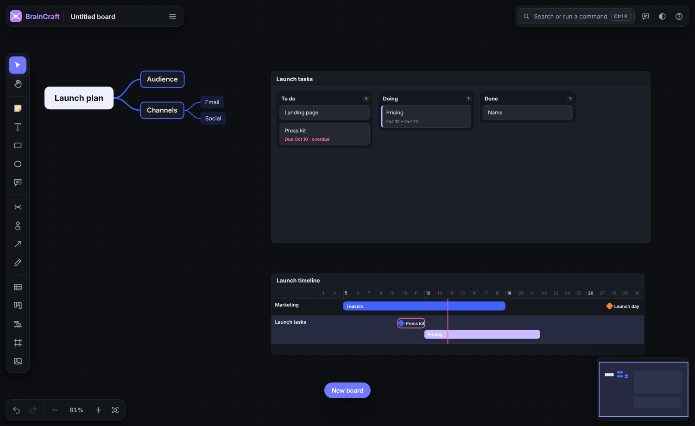
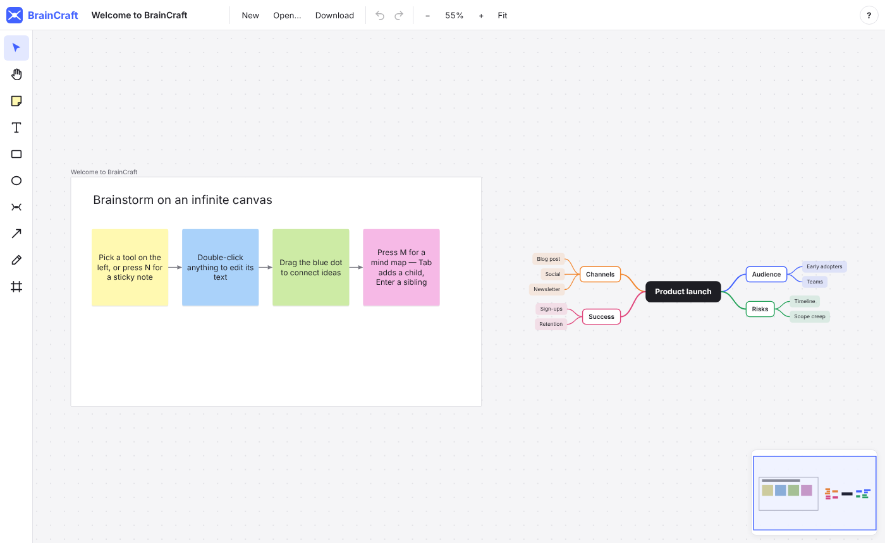
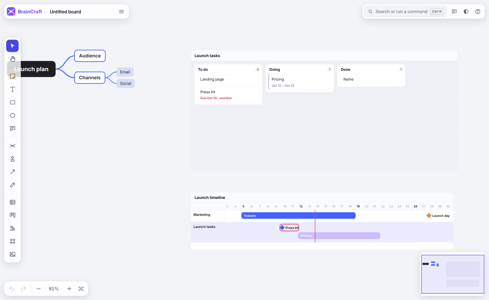
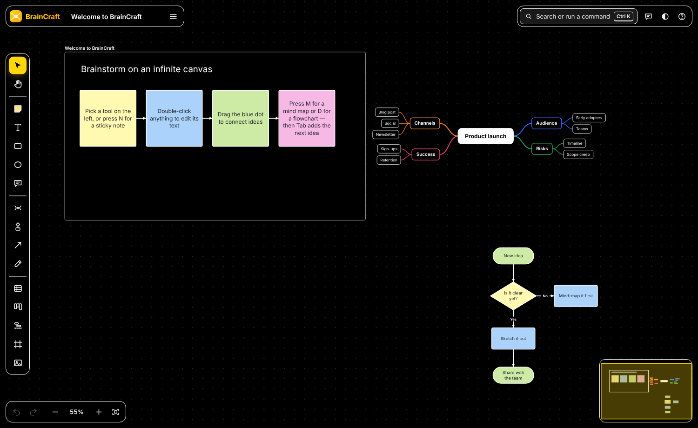
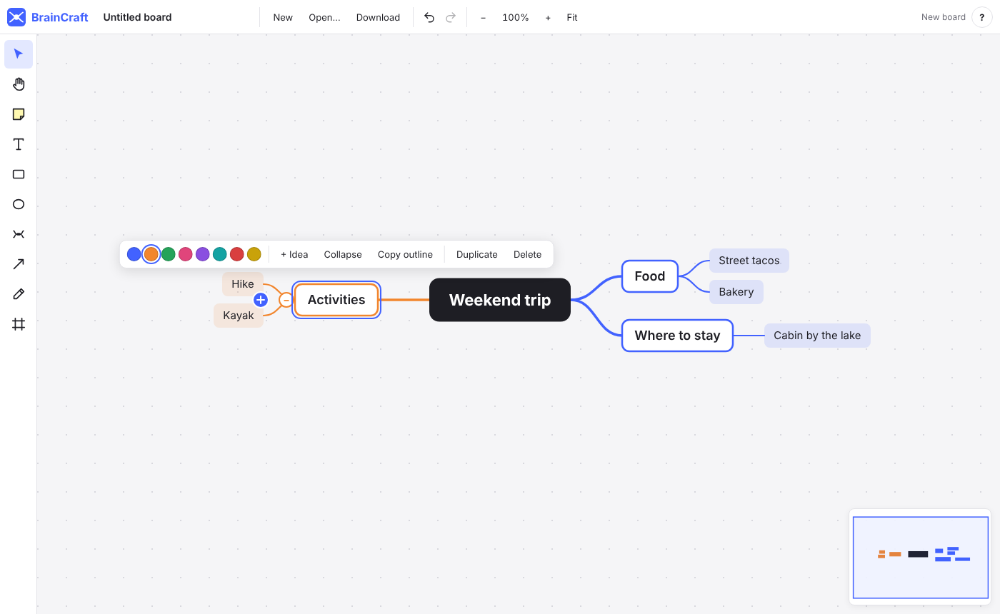
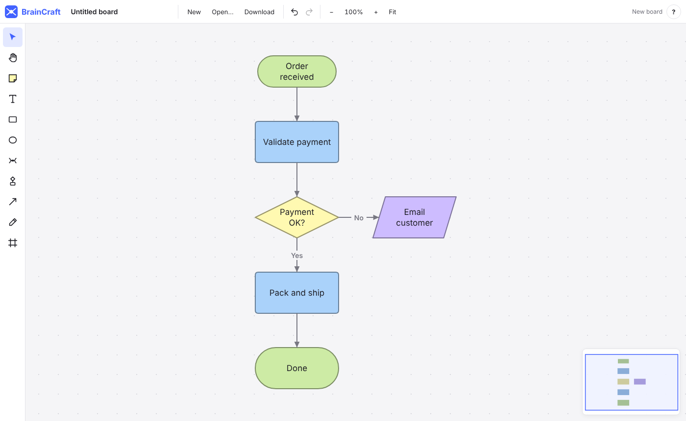

# BrainCraft

An infinite whiteboard for brainstorming: mind maps, flowcharts, tables,
Kanban boards, timelines and comments on one canvas. It runs entirely in the
browser as a static site, so you can host it anywhere.



## Look and feel

BrainCraft defaults to a **dark theme** and has three more: **light**,
**high contrast dark** and **high contrast light**. Pick one from the theme
button at the top right, or type "theme" in Ctrl+K. The high-contrast themes
use pure black and white surfaces, a vivid accent, bold outlines on every
shape, thicker lines and stronger focus rings. Default board colors (ink,
lines, frames, mind-map centers) follow the theme, so boards stay readable in
all four.

The board fills the window and the controls float above it:

- **Board menu** (top left): the board's icon and title, your boards, new,
  open, download, share, import and export, version history, connecting an AI
  assistant, and shortcuts.
- **Top right:** **Share**, **Ask AI**, **Present**, **Search** (Ctrl+K
  searches the board *and* runs any command by name; type `>` to show only
  commands), **Comments**, the theme and **Help** (?).
- **Tool rail** (left): hover any tool to see its shortcut.
- **Undo, redo and zoom** (bottom left), plus a **minimap** (bottom right).
- **Right-click** anything for the actions that apply to it.

| Dark | Light | High contrast dark |
| --- | --- | --- |
|  |  |  |

## Features

### Mind maps



- Press **M** and click to start a map, then type your central idea.
- **Tab** adds a sub-idea and **Enter** adds an idea below, so you can
  brainstorm without touching the mouse. An idea you leave empty is discarded.
- Branches lay themselves out on both sides of the central idea. Each main
  branch gets its own color, and its sub-ideas share it.
- Use the **arrow keys** to move between ideas and **Alt + ↑/↓** to reorder them.
- **Drag ideas anywhere.** Drop one on empty space and it stays there with its
  branch, and the lines follow. Drop it onto another idea to move the branch
  under it, or drag a main branch across the centre to switch sides.
  **Tidy mind map** (right-click) snaps everything back into the automatic
  layout.
- Select several ideas to move them together (the rest of the map stays
  put), or press **Ctrl+G** to group sibling ideas under a new one.
- **Collapse** a branch with **/** or with the toggle next to it.
- **Paste an indented list** (Markdown bullets, numbered lists, headings or
  plain indentation) to turn it into a map. **Copy outline** does the reverse.
  A flat list with no indents becomes sticky notes instead (see below).

### Flowcharts



- Press **D** (or pick the flowchart tool) to open the **shape panel**: Start/End,
  Process, Decision, Input/Output, Document, Database or Subprocess. It stays
  open while you build; close it with its **×** or **Esc**.
- **Drag shapes from the panel onto the board**, or click one and then click
  the board.
- **Magnets:** drop or drag a shape near another one and it snaps into line
  beside it, one gap away, and connects with an arrow automatically. The
  target glows and a dashed line previews the connection. Hold **Alt** to
  place it freely.
- With a shape selected, **Tab** adds the next connected step in the direction
  the flow is going. **Alt + arrow** adds one in that direction, e.g. the
  "No" branch of a decision. While you're typing in a shape, **Tab** finishes
  it and moves on to the next step.
- Selected shapes show **blue arrows** on each side. Click one to add a step
  that way, or drag it onto another shape (or onto empty space) to connect.
- New steps line up and space themselves automatically, sliding past shapes
  already in the way. Dragged shapes snap into line with their neighbors;
  hold **Alt** to move freely.
- Lines attach to the middle of a side and stay attached as you move things.
  Choose straight, right-angled or curved lines and which ends get arrows.
  **Double-click a line** to label it ("Yes", "No").
- Change a shape's symbol from the toolbar at any time.

- **Drag a blue arrow to empty space** and BrainCraft suggests the next
  shape, with a description of each. The order follows what this board uses
  most after that kind of shape, then the usual conventions. Press **1–7** to
  pick.
- **Mermaid:** paste a Mermaid flowchart (or use **Import / Export**) to build
  it, laid out automatically. Export any flowchart back to Mermaid for docs,
  GitHub or Notion.

A hint bar at the bottom of the canvas shows the shortcuts that apply to
whatever you have selected.

### Tables, Kanban boards and timelines

These become interactive once selected; drag them by their title strip.

- **Tables (G)**, or paste cells copied from Excel or Google Sheets. Edit
  cells inline (Enter moves down and adds a row at the end). Click a header to
  sort (numbers sort naturally). Filter by column. Hide rows and columns and
  bring them back. Insert and delete rows and columns, and copy as CSV.
- **Kanban boards (K):** drag cards between columns, or focus a card and
  press **Alt + arrows** (or use "Move to" in its ⋯ menu). Press Enter to keep
  adding cards. Cards have colors and start/due dates, and overdue cards are
  flagged.
- **Timelines (I):** lanes of events and milestones on a time axis that
  scales itself, with a "today" line. Drag to reschedule, drag the ends to
  change the length, double-click to add, and zoom and pan. A timeline can
  **follow Kanban boards**: their dated cards appear live in their own lane,
  overdue ones are flagged, and dragging a card on the timeline reschedules it
  on the board.
- **Timeline dependencies:** select an event and use **Waits for…** to pick
  what must finish first. Arrows join them; if an event starts too early its
  arrow turns red and dashed, and **Line up** moves events (and everything
  after them) so each starts the day after what it waits for.

### Comments and search

- **Every object has a description**: free text at the top of its comments
  panel for context, links or decisions. It's searchable, and AI assistants
  can read and set it.
- **Wiki-links.** Type **[[** in a description or comment to link to another
  board or to an object on this board. Links read as chips: click one to open
  that board or fly to that object. A typed `[[Name]]` links to whatever is
  called that; if nothing is yet, clicking it starts a board with that name.
  Every object lists what links to it under "Linked from", and with nothing
  selected the panel lists comments on your other boards that link to this
  one. Links to a shared board use its live-session id, so they work for
  every friend who has that board.
- **Every object has comments.** Select it and press **Alt+C** (or click
  *Comment*) to open the panel on the right. Notes are timestamped, show who
  wrote them, and can be deleted. Type **@** to mention another object; the
  mention links to it, and the other object lists it under "Linked from".
  With nothing selected, the panel shows every comment on the board.
- **Comment blocks (C)** are notes you can place anywhere on the board.
- **Ctrl+K** searches everything: text, comments, descriptions, statuses,
  code, table cells, database records, Kanban cards, timeline events and line
  labels, filtered by type. With an empty query it
  lists every object, so it doubles as the object lookup.

### Status marks

- **Mark where anything stands**: *to do*, *in progress*, *waiting*,
  *undecided*, *done* or *dropped*. Select objects and pick a status from the
  toolbar, or press **Ctrl+K** and type "mark as". Each status has its own
  colour and icon on the object; dropped ones fade.
- **Mind maps count progress**: an idea with marked ideas under it shows how
  many of them are done ("3/7"), turning green when they all are.
- **The status key** along the bottom counts each status on the board. Click
  one to dim everything else; click it again (or *Show all*) to see the whole
  board. Search finds statuses too, and the AI can read and set them.

### Reactions and dot voting

- **React** to anything with 👍 ❤️ 😂 🎉 🤔 ⭐ from the selection toolbar.
  Reactions show under the object with a count; hover to see who, click to
  add or take back yours.
- **Vote:** select the options (stickies, cards, shapes…) and press **Vote**.
  A vote card appears above them and everyone gets a few votes to spread
  around — click the dot on an option to vote, **−** (or Alt-click) to take
  one back. Counts stay hidden until someone presses **Reveal**; **End**
  closes the vote and crowns the winner, and **Sort** lines the options up
  by votes. It all syncs live and undoes like any other change.
- The AI assistant and MCP clients can react and start votes too.

### Boards, files and sharing

- **Your boards (Ctrl+O)** lists every board in this browser with a live
  thumbnail. Rename, duplicate or delete them, or start a new one from a
  template: blank, brainstorm, process map, sprint plan or retrospective.
- **Board icons:** click the face next to the board's title to give it an
  emoji. It shows in the board list, the browser tab and links to the board,
  and travels with the board in live sessions.
- **Export image or PDF (Ctrl+Shift+E):** the whole board or the selection
  as PNG or SVG, or straight to the clipboard to paste into a chat. The PDF
  has one page per frame, like the slides. Right-click → **Copy as image**
  does the selection in one step.
- Boards **autosave** as you work; the dot next to the title shows when
  they're saved.
- **Open the same board in several tabs** and they stay in step live, no
  server needed. Each tab keeps its own undo.
- **Version history** keeps a version every ten minutes plus any you name
  ("Before the reorg"). Preview any version and restore it in one undoable
  step; the board being replaced is kept as a version too.
- **Ctrl+S saves to a `.braincraft` file.** In Chrome and Edge it writes
  back to the same file each time; elsewhere it downloads a copy. Open
  files with **Open file…** or by dropping them on the window.
- **Share read-only link** packs the whole board, compressed, into the
  link itself. Nothing is uploaded. People who open it see the board
  read-only and can save their own copy.

### Linked data: one dataset, many views

- **Database (B)** adds a set of records with typed fields: text, number,
  date, choice, person and checkbox. Show it as a **table**, a **Kanban**
  (Kanban columns from a choice or person field), a **timeline** (bars
  from two date fields), a **calendar** (a month of days, each record on
  the days it covers; drag one to another day, double-click a day to add
  one) or a **gallery** (cards, with a picture from any field holding an
  image address), and switch between them in the title bar.
- **+ View** puts another view of the same records next to it. Every view
  stays in sync. Change a status in the table and the card moves on the
  board; drag a bar on the timeline and the dates change in the table.
- Each view has its own search, sort, hidden fields, grouping and date
  fields. Those never change the data itself.
- Click a card or bar to open the record and edit every field. Choices get
  colours; new ones are added as you type them.
- **Convert to linked data** (right-click) turns an existing table, Kanban
  board or timeline into a dataset, guessing each column's type.
- AI assistants can create and update databases by field name (see the
  [API](docs/API.md)).

### Runbooks: run a flowchart

- **Run flowchart (Alt+R)** turns a flowchart into a live procedure. The
  panel shows the current step, the shape's comments as instructions, and
  the ways on from it: one button for a step, one per answer for a decision
  (or press **1–9**). **Enter** moves on, **Backspace** goes back, and
  **Esc** stops.
- The board follows along, highlighting the current step, the route taken
  so far and the possible next steps.
- Add a note to any step as you go. Every run is timestamped and kept on the
  flowchart. **Run history** shows each run, the typical time, and the route
  runs usually take. Copy any run as a Markdown checklist for a ticket or
  chat.
- **Run from this step** starts part-way through.

### Live collaboration

- Run the BrainCraft server (one Node script, or Docker). Then **Share →
  Start a live session** gives you an edit link and a view-only link.
- Everyone sees changes as they happen, with named cursors, selections,
  who's here (avatars in the top bar) and **follow** (click an avatar to see
  what they see).
- Edits merge per object. Undo takes back only your own steps, and offline
  work syncs when the connection returns.
- The server also provides an **HTTP API**: post operations to a board from
  scripts, bots or CI. See [docs/SERVER.md](docs/SERVER.md).

### Since you were here

- Come back to a board your friends worked on (in a live session, or after
  your tab was in the background) and a banner says what changed: new,
  changed and removed objects and new comments. **Show me** highlights them
  on the board — green for new, blue for changed, red crosses for what went —
  with a list that flies to each one. **Summarise with AI** asks the assistant
  for the short version.
- It says **who**: "3 new · 2 changed · by Sam and Alex", and each row in the
  list names the person. Every object remembers who last changed it (by the
  name you post comments under, or your guest name).
- Each browser remembers how it last saw each board; your own edits never
  count as news.

### Together in the moment

- **E** sends an emote (👍 ❤️ 😂 🎉 🤔 ⭐ — or press 1–6 in the picker) that
  floats up from your cursor for everyone in the live session.
- **/** opens cursor chat: type a line and it appears next to your cursor
  for a few seconds.
- **Timers:** "Start a 5-minute timer" in Ctrl+K (1, 3, 5 or 10 minutes).
  Everyone sees the same countdown — people who join late too — with
  +1 min and stop, and a chime at the end.
- All of these work alone as well; nothing is saved into the board.
- **Private brainstorm** (right-click empty space, or Ctrl+K): a card with
  the question appears, and until someone clicks **Reveal all**, every sticky
  note people write shows only to its writer. Everyone else sees a blank
  card with the writer's name, and the card counts the notes so far. That
  way nobody's first idea steers the rest. Search and the assistant don't
  see hidden notes either. (As with hidden votes, they're hidden on screen:
  every browser in the session holds the whole board.)
- **Spinner wheel** (right-click, or Ctrl+K): a wheel whose options are the
  card's lines; double-click it to change them. Select a few sticky notes
  first and their text becomes the options. **Spin** and everyone in the live
  session watches the same wheel land on the same answer.
- **Flip cards:** select a sticky note and click **Flip card** to give it a
  back. The ↻ button on the card turns it over for everyone, so you can put
  the question on the front and the answer on the back. Write on whichever
  side is showing.

### Presenting

- **Present (Shift+P)** turns the board's frames into slides, in reading
  order, full screen. The camera flies from frame to frame and small frames
  zoom to fill the screen.
- Arrow keys, Space or a click go forward; number keys jump to a slide.
- **L** is a laser pointer with a fading trail, **N** shows speaker notes
  (the frame's comments), and **O** zooms out to the whole board.
- Start with a frame selected to present from there. A board without frames
  presents as one slide.

### Ask AI: an assistant inside the board

- **Ctrl J** (or **Ask AI**, top right) opens a chat with Claude about the
  board you're looking at. It reads the board, knows what you've selected,
  and links every object it mentions so you can click straight to it.
- **Changes are previewed, never just made.** When you ask for changes
  ("cluster these stickies into themes", "turn this into a flowchart"), the
  proposal appears on the board as ghosts: new objects outlined in green,
  removed ones crossed out in red. **Apply** or **Discard** it.
- **AI history.** Every applied change is listed under History with its own
  **Undo** and **Redo**, which work even after you've made other edits. The
  history is kept with the board.
- One-click actions: Summarise, Find gaps, Decision log, and with a selection,
  Cluster into themes, Make a mind map and Make a flowchart.
- **Sketch to board:** draw a rough flowchart or mind map with the pen, or
  drop in a photo of a napkin or whiteboard, select it and press
  **✦ To board**. Claude reads the picture and proposes real shapes, ideas or
  notes beside it — previewed first, like every AI change.
- Use the BrainCraft server's key (its owner pays) or paste your own Anthropic
  API key, which stays in your browser. Claude Opus 5.5 by default; Sonnet 5.5
  and Haiku 5.5 are options. See [docs/AI.md](docs/AI.md).

### AI assistants (MCP) and the API

- **Connect Claude, Cursor or any MCP client** to work on your boards live:
  it reads the board, builds mind maps, flowcharts and Kanban boards, and
  leaves comments, and every change is one undo step. Or point it at
  `.braincraft` files with no browser at all. See [docs/MCP.md](docs/MCP.md).
- Boards can also be built from JSON operations: paste them, or call
  `window.BrainCraft.apply([...])`. See [docs/API.md](docs/API.md), which
  includes a ready-made prompt for AI assistants.

### Whiteboard

- An infinite canvas with a dot grid. Pan, zoom from 5% to 800%, zoom to fit,
  use the minimap, or pinch on touch screens.
- Sticky notes, text, rectangles, ellipses, frames and a freehand pen.
- **Connectors**: drag the blue dot on a selected item onto another item.
  Drop it on empty space to create a new linked note.
- Frames carry their contents when you move them.
- **Magnets:** drag a shape near another and it snaps one step away and
  connects. Sticky notes snap into neat rows and columns without lines. Hold
  **Alt** to place freely.
- **Align and distribute:** select several objects and use **Align** in the
  toolbar, or search "align" in Ctrl+K.
- **Ctrl + arrow** nudges anything by 10 (Shift for 50), mind-map ideas
  included.
- Select with a click, shift-click or a drag box. Resize from the corners,
  and use the floating toolbar for color, text size, layer order, duplicate
  and delete.
- Copy, cut and paste work through the system clipboard. Plain text you
  paste becomes a sticky note. **Paste a list** (one idea per line, bullets
  fine) to get a tidy grid of sticky notes, one per line; Ctrl+K → "Add many
  sticky notes" opens a box to type them in. **Paste or drop images** to add them.
- **Code blocks:** paste a fenced block from a chat (```lang … ```), or
  right-click → *Code block*, for code with coloured keywords, strings and
  comments. The language is guessed, or pick it on the block; **Copy** puts
  the code on the clipboard, and Tab indents while you edit.
- **Paste a web address** to get a link card with the page's title, picture
  and site (filled in by the BrainCraft server; without one, the card shows
  the address). **YouTube, Vimeo and Spotify** links play right on the card:
  select it to load the player. The arrow on the card opens the page in a new
  tab.
- **Lock (Ctrl+Shift+L)** a background, image or layout so it can't be
  clicked, moved or changed by accident; right-click or Alt-click it to
  unlock. **Group (Ctrl+G)** any objects so they select and move as one;
  Ctrl+Shift+G ungroups.
- **Type to rename:** with one object selected, just start typing.
- **Keyboard and touch:** with a tool picked, **Enter** puts one in the
  middle of the view (so does choosing "Add …" in Ctrl+K). On touch screens,
  **press and hold** for the menu that right-click opens.
- Undo and redo; deleting tells you what went, in case it was a slip.

Press **?** in the app to see every shortcut.

## Development

Requires Node 20 or later.

```sh
npm install
npm run dev      # dev server at http://localhost:5173
npm run check    # typecheck, lint and unit tests
npm run build    # production build in dist/, including dist/braincraft-mcp.mjs
npm run mcp      # run the built MCP server (normally your AI client starts it)
npm run serve    # run the BrainCraft server (app + live sessions + HTTP API) on :8080
```

## Hosting

`npm run build` produces a fully static `dist/` folder with relative asset
paths. Serve it from any static host, at the domain root or under a sub-path:

- **GitHub Pages**: the included workflow (`.github/workflows/ci.yml`) tests,
  builds and deploys `main`. Enable it under *Settings → Pages → Source:
  GitHub Actions*.
- **Netlify / Cloudflare Pages / Vercel**: set the build command to
  `npm run build` and the output directory to `dist`.
- **Anything else**: copy `dist/` to any web server.

As a static site, boards live in each visitor's browser (IndexedDB) until
they save them to a file or share a link. The build also publishes
`braincraft-mcp.mjs`, so the app's AI dialog can offer the MCP server for
download from wherever you host it.

For live collaboration, shared boards and the HTTP API, run the BrainCraft
server instead. It serves the app as well:

```sh
node dist/braincraft-server.mjs            # or: docker run -p 8080:8080 -v braincraft-data:/data braincraft
```

See [docs/SERVER.md](docs/SERVER.md).

## Code layout

| Path | Purpose |
| --- | --- |
| `src/model/` | The document: items, connectors, hit testing, copy/paste, mind maps, flowcharts and Mermaid, tables, Kanban boards, timelines, link cards, comments and wiki-links, search, undo history, serialization. Pure functions over immutable data. |
| `src/ai/` | The in-app assistant: the Claude conversation, its tools, proposals and settings. |
| `src/api/` | The operations API (`window.BrainCraft`, pasted JSON), the AI tools shared with the MCP server, and the browser end of the MCP link. |
| `src/store/` | The board library in IndexedDB, versions, files, share links and autosave. |
| `src/collab/` | Live collaboration: board patches (also used by undo), the wire protocol, the server's room logic and the browser's live session. |
| `server/` | The BrainCraft server: hosting, shared boards, WebSockets, the HTTP API, link previews and the AI proxy, bundled into one Node script. |
| `mcp/` | The MCP server for AI assistants, bundled into one Node script. |
| `src/editor/Editor.ts` | Tools, selection, gestures and keyboard commands. Framework-independent and unit-tested. |
| `src/ui/` | React components: SVG canvas, toolbars, text editing, comments panel, search, dialogs, and the table/Kanban/timeline views. |

## License

Licensed under either the [Apache License 2.0](LICENSE-APACHE) or the
[MIT license](LICENSE-MIT), at your option.
