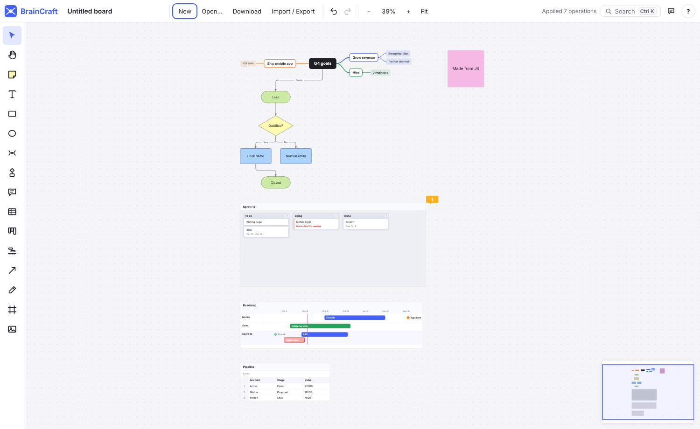

# BrainCraft API

BrainCraft boards can be built and read by scripts and AI assistants. The API
is a small JSON language of **operations** ("create a mind map", "connect these
two", "add a comment"). The same operations work in four places:

| Where | How |
| --- | --- |
| **Paste** | Paste JSON operations anywhere on the board, or use **Import / Export → Import**. |
| **JavaScript** | `window.BrainCraft.apply([...])` in the page (browser console, extensions, embedding pages). |
| **HTTP** | `POST /api/boards/{id}/ops` on a [BrainCraft server](SERVER.md), with the board's edit key. Everyone looking at the board sees the result live. The server lists every route at `/api/docs` and as OpenAPI at `/api/openapi.json`. |
| **MCP** | AI assistants call the `apply_ops` tool (see [MCP.md](MCP.md)). |

A batch is applied **all or nothing** and is a **single undo step**: if any
operation is invalid, nothing changes and the error names the operation and the
field at fault.

## Quick example

```json
{
  "ops": [
    { "op": "createMindMap", "ref": "goals", "outline": "Q4 goals\n  Grow revenue\n    Enterprise plan\n  Ship mobile app" },
    { "op": "createFlowchart", "ref": "flow", "mermaid": "flowchart TD\n  A([Lead]) --> B{Qualified?}\n  B -->|Yes| C[Demo]\n  B -->|No| D[Nurture]" },
    { "op": "createKanban", "ref": "sprint", "title": "Sprint 12", "columns": [
        { "title": "To do", "cards": ["Pricing page", { "title": "SSO", "due": "2026-10-30" }] },
        { "title": "Doing", "cards": [] },
        { "title": "Done", "cards": [] } ] },
    { "op": "createTimeline", "title": "Roadmap", "followKanban": ["sprint"], "lanes": [
        { "name": "Mobile", "entries": [{ "title": "Beta", "start": "2026-11-01", "end": "2026-11-20" }] } ] },
    { "op": "connect", "from": "goals", "to": "flow", "label": "feeds" },
    { "op": "addComment", "id": "sprint", "text": "Scope agreed with sales" }
  ]
}
```

Pasting that produces:



### Linked data example

```json
{
  "ops": [
    {
      "op": "createDatabase", "ref": "roadmap", "title": "Roadmap",
      "views": ["table", "board", "timeline"], "groupBy": "Status",
      "records": [
        { "Feature": "SSO", "Status": "In progress", "Owner": "Sam", "Start": "2026-10-01", "End": "2026-10-20", "Points": 8 },
        { "Feature": "Exports", "Status": "To do", "Owner": "Jo", "Start": "2026-10-15", "End": "2026-11-02", "Points": 3 }
      ]
    },
    { "op": "updateRecord", "id": "roadmap", "record": "Exports", "values": { "Status": "In progress" } }
  ]
}
```

That makes one set of records shown three ways. Moving "Exports" to *In
progress* moves its card on the board and recolours its bar on the
timeline.

## Conventions

- **Refs.** Any create operation can take `"ref": "name"`. Later operations in
  the same batch can use that name wherever an object id is expected. Existing
  objects are referred to by their numeric `id` (see `list()` below).
- **Placement.** `"at": {"x": …, "y": …}` puts the object's top-left corner at
  that board position. Without `at`, new objects are stacked in a column to the
  right of everything already on the board, so they never overlap existing
  work.
- **Dates** are `YYYY-MM-DD`.
- **Colours** are hex (`"#aad2fa"`) or a palette name: yellow, orange, red, pink,
  violet, blue, cyan, green, gray, white.

## Operations

| Operation | Fields | Creates |
| --- | --- | --- |
| `createNote` | `text`, `color?`, `w?`, `h?` | Sticky note |
| `createText` | `text`, `fontSize?` (28), `w?` | Free text |
| `createShape` | `shape?` (`rect` \| `ellipse`), `text?`, `color?`, `w?`, `h?` | Shape |
| `createComment` | `text` | Comment block, timestamped |
| `createFrame` | `title`, `around?` (ids/refs to enclose) or `w?`, `h?` | Frame (sent behind its contents) |
| `createMindMap` | `outline` (indented list, Markdown bullets OK) or `tree` (`{"text", "children": [...]}`) | Mind map, laid out automatically |
| `createFlowchart` | `mermaid` (a Mermaid `flowchart`/`graph`) | Flowchart, laid out automatically |
| `createTable` | `columns` (names), `rows?` (lists of cell values), `title?` | Table |
| `createKanban` | `columns?` (`[{"title", "cards": [text \| {"title", "start?", "due?", "color?"}]}]`), `title?` | Kanban board (default: To do / In progress / Done) |
| `createTimeline` | `lanes?` (`[{"name", "entries": [{"title", "start", "end?", "color?"}]}]`), `followKanban?` (Kanban ids/refs), `title?`, `w?`, `h?` | Timeline. An entry without `end` is a milestone. Followed Kanban boards show their dated cards live. |
| `createImage` | `src` (`data:image/…` or `https://…`), `w?`, `h?` | Image |
| `createCode` | `code`, `lang?`, `w?`, `h?` | Code block with syntax colouring; the language is guessed when left out. |
| `createSpinner` | `options` (two or more) | Spinner wheel card. Anyone can spin it; everyone sees the same answer. |
| `createLink` | `url` (one `http(s)` address), `w?`, `h?` | Link card. Its title, description and picture fill in once the app (connected to a BrainCraft server) reads the page. YouTube, Vimeo and Spotify links play on the card. |
| `connect` | `from`, `to`, `label?`, `style?` (`straight` \| `elbow` \| `curved`), `arrows?` (`end` \| `both` \| `none`), `dashed?` | Line between two objects. Lines to flowchart shapes default to `elbow`. |
| `update` | `id`, `text?`, `description?`, `color?`, `x?`, `y?`, `w?`, `h?`, `locked?`, `status?`, `sketch?` | — (`description` is the free text above an object's comments; `status` is `todo`, `doing`, `waiting`, `undecided`, `done`, `dropped`, or `none` to clear it; `sketch: true` draws it by hand) |
| `delete` | `ids` | — (deleting a mind-map idea deletes its branch) |
| `addComment` | `id`, `text`, `author?` | Timestamped comment on the object. Mention other objects with `@[Label](#id)`. |
| `createDatabase` | `title?`, `fields?` (names or `{"name", "type", "options?"}`), `records?` (objects keyed by field name), `views?` (`table` \| `board` \| `timeline` \| `calendar` \| `gallery`), `groupBy?` | One dataset shown as linked views that stay in sync. Field types: `text`, `number`, `date`, `select`, `person`, `checkbox`; guessed from the values when not given. The first field is each record's title. A board groups by `groupBy` (a choice or person field); a timeline uses the first two date fields. With no fields or records, a sample project list. |
| `addRecords` | `id` (any view), `records` | Adds records; new choice values become new options. |
| `updateRecord` | `id` (any view), `record` (record id or title), `values` | Sets fields by name; `null` or `""` clears one. |
| `deleteRecords` | `id` (any view), `records` (ids or titles) | — |
| `react` | `ids`, `emoji`, `by?` | Puts an emoji reaction on the objects (`by` defaults to "AI"). |
| `createVote` | `options` (ids/refs), `question?`, `each?` | A dot vote: a card above the options. Each person spreads `each` votes; counts stay hidden until someone reveals them. |

**Wikis.** A wiki is a board with pages instead of a canvas; only these
operations work on it, and they work only on wikis. `page`, `parent` and
`before` take a page id, a `ref` from earlier in the batch, or an exact title.
Results carry the page's id as `page`.

| Operation | Fields | Does |
| --- | --- | --- |
| `createPage` | `title`, `parent?`, `before?`, `text?` (Markdown), `icon?`, `ref?`, `note?` | A page under `parent` (or at the top), before `before` or last; its first version carries `note`. |
| `updatePage` | `page`, `title?`, `text?`, `append?`, `icon?`, `note?`, `protected?` | `text` replaces the page's Markdown; `append` adds a line at the end; `note` says what changed. The page's history keeps a version from before and after. `protected: true` lets only the wiki's managers change it and the pages under it (with accounts, only they may set it). |
| `movePage` | `page`, `parent?` (`null` for the top), `before?` | Moves it with its sub-pages. A page can't go inside its own sub-pages. |
| `deletePage` | `page` | Moves it and its sub-pages to the trash. |

A line `![[Label|height]](board:KEY#ID)` on its own embeds a canvas object
(a frame with what's in it, a mind map, a table…) in the page, and
`![[Label]](board:KEY)` a whole board; `|height` (in pixels) is optional.

Page Markdown links a page with `[[Title]](page:ID)` (or `[[Title]]` by name),
a heading with `[[Title › Heading]](page:ID#anchor)`, a page of another wiki
with `[[Title]](board:KEY/page:ID)`, and an object on a canvas board with
`[[Label]](board:KEY#ID)`. The same links work in canvas comments and
descriptions.

**Links in comments and descriptions.** Write `[[Name]]` to link to the board
titled *Name*, a wiki page with that title (when only one wiki has it), or else
the object on this board labelled *Name*. The app
stores links it picks as `[[Label]](#id)` (an object here), `[[Label]](board:key)`
(a board) or `[[Label]](board:key#id)` (an object on another board), where
`key` is the board's live-session id when it is shared and its id in the
browser otherwise. Reads (`get`, `find`) return comments and descriptions with
links shown as their labels.

Every operation returns a result: `{ "op", "id"?, "ids"?, "ref"? }`. `ids` lists
everything a multi-object operation (mind map, flowchart) created.

### Mermaid support

`createFlowchart` (and pasting Mermaid) reads `flowchart`/`graph` with any
direction (`TD`, `LR`, `BT`, `RL`), node shapes `[ ]` process, `{ }` decision,
`([ ])` and `(( ))` start/end, `[/ /]` input/output, `[( )]` database,
`[[ ]]` subprocess, `>text]` and `@{ shape: doc }` document. Links can be `-->`,
`---`, `-.->`, `==>`, `<-->` and `A & B --> C`, and labels can be written as
`-->|label|` or `-- label -->`. `subgraph`, `classDef`, `style` and `click`
lines are skipped.

On a server, wiki pages also have their own routes (`POST`, `PUT` and `DELETE`
on `/api/boards/{id}/pages…`), and any board comes out as a file from
`/api/boards/{id}/export?format=json|md|html|zip`.

The server's reads give the same answers as `list`, `get` and `find` below:
`GET /api/boards/{id}/objects`, `/objects/{objectId}`, `/search?q=`,
`/mermaid`, and for wikis `/pages`, `/pages/{page}` and `/pages/{page}/history`
(see [SERVER.md](SERVER.md)).

## JavaScript

```js
const api = window.BrainCraft

api.apply([{ op: 'createNote', text: 'Hello' }])   // → [{ op: 'createNote', id: 42 }]
api.list()                // every object: { id, kind, label, x, y, w, h, commentCount }
api.list('kanban')        // only Kanban boards
api.get(42)               // one object with its text, comments and data (table CSV, cards, mind-map outline…)
api.find('pricing')       // search text, comments, table cells, cards, timeline events and line labels
api.exportMermaid()       // every flowchart as Mermaid (or pass ids)
api.getBoard()            // the whole board as plain JSON (the downloaded file format)
api.select([42]); api.zoomTo([42]); api.selection
api.operations            // names of all operations
```

## Prompting an AI assistant

Paste this into Claude (or any assistant) together with your request, then
paste its JSON answer into BrainCraft:

````text
You generate content for BrainCraft, a whiteboard. Answer with only a JSON
object {"ops": [...]}, no prose. Available operations:
- createNote {text, color?}            - createText {text, fontSize?}
- createShape {shape: rect|ellipse, text?, color?}
- createComment {text}                 - createFrame {title, around: [refs]}
- createMindMap {outline: "indented list, two spaces per level"}
- createFlowchart {mermaid: "flowchart TD ..."}   (Mermaid flowchart syntax)
- createTable {title?, columns: [names], rows: [[cells]]}
- createKanban {title?, columns: [{title, cards: [text or {title, due: "YYYY-MM-DD"}]}]}
- createTimeline {title?, lanes: [{name, entries: [{title, start, end?}]}], followKanban?: [refs]}
- createDatabase {title?, fields?, records?: [{field: value}], views?: [table|board|timeline|calendar|gallery]}
- createSpinner {options: [text]}      - createVote {options: [refs], question?}
- connect {from, to, label?}           - addComment {id, text}
- update {id, status?: todo|doing|waiting|undecided|done|dropped}
- react {ids: [refs], emoji}
Give created objects a "ref" name and use it in later operations. Leave out
positions ("at"); BrainCraft lays things out. Dates are YYYY-MM-DD.
````
